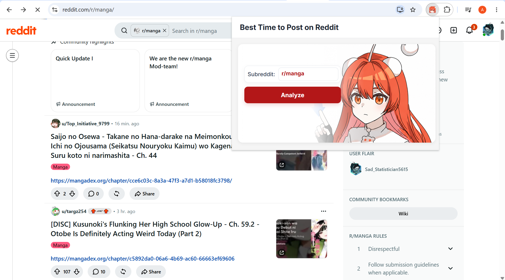

# Best Time to Post on Reddit

A Chrome extension that helps you find promising times to post in a subreddit.

## What it shows

- A day and hour heatmap of **average post score**.
- A suggested posting time and an alternative.

## Install

1. Download or clone this repository.
2. Open `chrome://extensions` in Chrome and turn on **Developer mode**.
3. Select **Load unpacked** and choose the repository folder containing `manifest.json`.

No build step is required; the popup, chart library, styles, fonts, and images are included in the repository.

## Use

1. Open a subreddit page.
2. Click the extension icon. The popup detects the subreddit from the active tab.
3. Click **Analyze** and scroll through the results.

The Analyze button is disabled when the active tab is not a subreddit page.

## Preview

> [!NOTE]
> Analysis requires access to Reddit's JSON endpoints.
